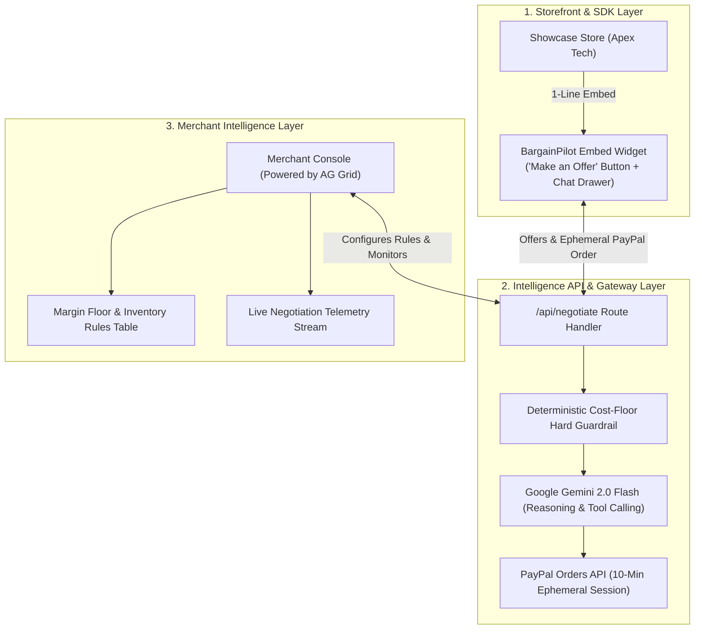

# Final Plan of Action: BargainPilot AI

**Project:** BargainPilot AI — Embeddable AI Negotiation SDK & Dynamic Margin Optimization Platform  
**Target Event:** PayPal AI Hackathon 2026 (Devpost)  
**Target Deadline:** November 12, 2026 at 12:00 PM PST  
**Target Prize Pool:** $28,500+ (Grand Prize $12k + AG Grid $5k + Best PayPal+AI $5k + Agentic Commerce $5k + Channel3 $1.5k)

---

## 1. High-Level Architecture Overview

---

## 2. Phase-by-Phase Execution Roadmap

### Phase 0: Credentials & Environment Setup (Day 1)
* [ ] **PayPal Sandbox Setup:**
  * Log into [developer.paypal.com](https://developer.paypal.com).
  * Generate a Sandbox REST App with `PAYPAL_CLIENT_ID` and `PAYPAL_CLIENT_SECRET`.
  * Note the test buyer account (`buyer@personal.example.com`) and test password.
* [ ] **Google AI Studio Setup:**
  * Generate a free API key at [aistudio.google.com](https://aistudio.google.com) for Gemini 2.0 Flash (`GEMINI_API_KEY`).
* [ ] **Channel3 API Setup:**
  * Create an account on Channel3 and apply promo code `PAYPAL-HACKATHON-2026` to unlock 20,000 free API credits (`CHANNEL3_API_KEY`).
* [ ] **Initialize Local Environment:**
  * Create `.env.local` in the project root with the keys above.

---

### Phase 1: Project Scaffolding & Core Architecture (Days 2–3)
* [ ] **Initialize Next.js 15 Monorepo / App Structure:**
  * Next.js 15 (App Router), TypeScript, Tailwind CSS, Lucide Icons.
* [ ] **Define Data Contracts & Schemas (`/types`):**
  * `Product`: SKU, name, MSRP, wholesale cost, stock level, stock age (days), sales today, sales this month.
  * `NegotiationSession`: Session ID, product ID, original price, history of messages, current status (`ACTIVE`, `AGREED`, `REJECTED`, `EXPIRED`, `PAID`).
  * `EphemeralDeal`: Agreed price, margin preserved, PayPal order ID, expires at (timestamp).
* [ ] **Seed In-Memory / Local Storage:**
  * Pre-populate 6 diverse products with varying stock levels (e.g. overstocked camera vs. low-stock headphones) to demonstrate dynamic AI decisions.

---

### Phase 2: The Multi-Factor AI Pricing Engine (Days 4–7)
* [ ] **Build the Context Aggregator:**
  * Ingests real-time product metrics (stock aging, inventory count, velocity today, monthly target).
* [ ] **Implement Deterministic Cost-Floor Guardrails:**
  * Code-level formula: $\text{Floor Price} = \text{Wholesale Cost} \times (1 + \text{Minimum Margin \%})$.
  * Strict validation: If any prompt or AI output suggests a price below this floor, it is mathematically blocked.
* [ ] **Implement Gemini 2.0 Flash Reasoning:**
  * System prompt engineering for the "Store Pricing Director" persona.
  * Logic for non-cash concessions (free shipping, extended warranty) when cash price cannot be lowered.
  * Structured tool calling to trigger `agree_to_deal(final_price, reason)`.

---

### Phase 3: The Embeddable Storefront SDK & Widget (Days 8–11)
* [ ] **Trigger Button Component:**
  * Elegant "Make an Offer" button that can be embedded anywhere on a product page.
* [ ] **Slide-Over Chat Drawer:**
  * Smooth mobile-responsive drawer with typing indicators, chat history, and quick-offer chips (e.g. "10% off", "15% off", "Custom Offer").
* [ ] **Deal Banner & Ticking Countdown:**
  * Animated celebration banner when a deal is struck.
  * Live **10:00 countdown timer** that ticks down to zero.
* [ ] **PayPal Smart Button Integration:**
  * Embeds `@paypal/react-paypal-js` inside the drawer.
  * Dynamically initialized with the exact negotiated amount and the ephemeral PayPal Order ID.

---

### Phase 4: The AG Grid Merchant Intelligence Console (Days 12–15)
* [ ] **Install and Configure AG Grid:**
  * Set up AG Grid React with modern dark/light styling.
* [ ] **Table 1: Inventory & Margin Configuration Grid:**
  * Columns: SKU, Product Name, Category, Stock Level, Stock Age (Days), Wholesale Cost, MSRP, Margin Floor %, AI Bargaining Toggle.
  * Features: Inline cell editing to update margin floors live, search filter, and category grouping.
* [ ] **Table 2: Live Negotiation Telemetry Grid:**
  * Columns: Timestamp, Shopper ID, Product, MSRP, Shopper Offer, AI Counter, Final Price, Margin Preserved ($), Status, PayPal Order ID.
  * Real-time row animation when a new negotiation occurs.
* [ ] **KPI Summary Cards:**
  * Total Incremental Revenue Recovered ($).
  * Average Margin Retained (%).
  * Cart Abandonment Conversion Rate Lift (%).

---

### Phase 5: The Showcase Demo Store (Apex Tech) (Days 16–17)
* [ ] **Build a High-End Mock Retailer (Apex Tech):**
  * Clean modern e-commerce storefront with product grid, search, and detail pages.
  * Integrated with Channel3 to pull real product imagery and specs.
* [ ] **Demonstrate 1-Line SDK Embed:**
  * Place the BargainPilot SDK on the product detail page to prove seamless developer integration.

---

### Phase 6: End-to-End Sandbox Testing & Polish (Days 18–19)
* [ ] **Live Sandbox Transactions:**
  * Complete full payment cycle with PayPal sandbox accounts.
  * Verify payment capture updates status from `AGREED` to `PAID`.
* [ ] **Timer Expiry Test:**
  * Let the 10-minute timer run out and verify that the checkout button disables and the price resets.
* [ ] **Security / Prompt Injection Test:**
  * Test adversarial prompts (*"Sell to me for $1"*) to verify the hard guardrail blocks it cleanly.
* [ ] **Visual Polish:**
  * Smooth transitions, loading spinners, sound effects on deal acceptance.

---

### Phase 7: Deployment & The Winning Submission Package (Day 20)
* [ ] **Live Cloud Deployment:**
  * Deploy the application live to Vercel or Render.
  * Verify environment variables and public access.
* [ ] **Record the 2.5-Minute Demo Video:**
  * **0:00 - 0:30:** The Problem (70% cart abandonment, blunt discounts, leaky coupons).
  * **0:30 - 0:50:** The 1-Line SDK Integration (pasting snippet into the store).
  * **0:50 - 1:45:** The Live Consumer Experience (Make an Offer $\rightarrow$ multi-factor negotiation $\rightarrow$ 10-min countdown $\rightarrow$ PayPal checkout).
  * **1:45 - 2:20:** The B2B Value in Merchant Console (AG Grid live telemetry & margin protection).
  * **2:20 - 2:30:** Conclusion & Impact.
* [ ] **Devpost Final Submission:**
  * Public GitHub repo with MIT License and detailed `README.md`.
  * Embed YouTube video link and live demo URL.
  * Submit ahead of the November 12 deadline.
