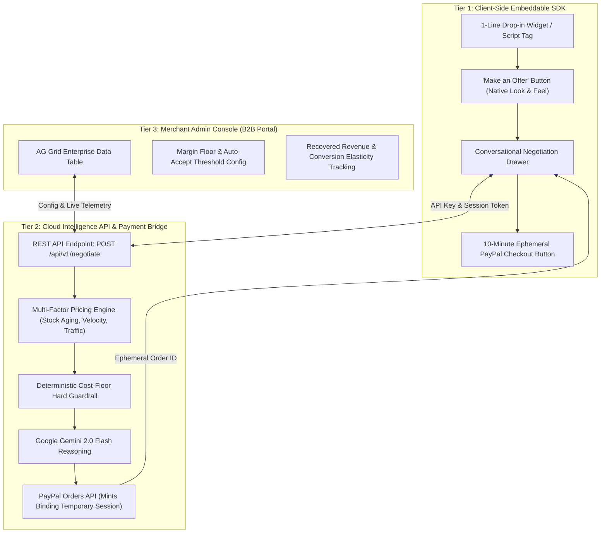

# Project Details: BargainPilot AI

**Product Definition:** Embeddable AI Negotiation SDK & Dynamic Margin Optimization Platform  
**Architecture:** B2B Developer SDK + Cloud Intelligence API + AG Grid Merchant Console  
**Hackathon:** PayPal AI Hackathon 2026 (Devpost)  
**Target Prizes:** Grand Prize ($12,000), Best Use of PayPal + AI ($5,000), AG Grid Sponsor Award ($5,000), Best Use of Agentic Commerce ($5,000)

---

## 1. Executive Summary & Product Classification

**BargainPilot AI** is the *"Stripe Elements of Dynamic Pricing & Negotiation"*. 

Instead of building a standalone consumer shopping website, BargainPilot is a **B2B developer platform and embeddable SDK** that existing e-commerce merchants (Shopify stores, custom retailers, or enterprise marketplaces like Amazon) can integrate into their product pages with a single line of code.

When a price-sensitive shopper clicks **"Make an Offer / Negotiate"**, a native conversational drawer slides open. The **Store's Seller AI** dynamically evaluates live warehouse stock aging, sales velocity (today vs. monthly quota), profit margin floors, and live site traffic to negotiate in real time. 

The moment a deal is struck, the platform bypasses leaky coupon codes by issuing an **ephemeral 10-minute binding PayPal Checkout session** directly inside the drawer. Merchants monitor, configure, and protect their margins through an enterprise **AG Grid Intelligence Console**.

---

## 2. Who Are the Customers vs. End Users?

* **The Customer (B2B):** E-commerce merchants, brands, and platforms who want to recover abandoned carts and maximize revenue without destroying their margins with blanket sales.
* **The End User (B2C):** The merchant's shoppers who want a fair deal on items they are hesitating to buy.
* **The Business Model:** B2B Developer Tool / SaaS (charging merchants a percentage of recovered cart revenue or a monthly API tier).

---

## 3. The Core Problem

### A. The $4 Trillion Cart Abandonment Epidemic
* Approximately **70% of online shopping carts are abandoned**, predominantly due to price hesitation and sticker shock.
* Shoppers regularly exit stores to compare prices on Amazon or hunt for coupons on Reddit and Honey.

### B. Blunt, Margin-Killing Sitewide Discounts
* Today, merchants rely on crude, blanket tools (e.g., *"Take 15% off sitewide!"* popups).
* This needlessly burns profit margins on scarce, high-demand items that would have otherwise sold at full retail price.

### C. The "Leaky Coupon Code" Trap of First-Gen AI Tools
* Existing first-generation tools (such as Nibble AI or DBargain) simply spit out a text promo code (e.g., `NIBBLE12`) at the end of a chat.
* **The Flaw:** The shopper copies the code, opens another tab, gets distracted, and still abandons the cart. Furthermore, the coupon leaks onto Honey or Reddit, allowing full-price shoppers to claim unwarranted discounts.

### D. High Engineering Barrier to Custom Negotiation
* An e-commerce merchant cannot easily build their own negotiation system from scratch. It requires weeks of frontend UI engineering, state management, LLM prompt engineering, security firewalls, and payment gateway bindings.

---

## 4. The 3-Tier System Architecture



---

## 5. Detailed Component Breakdown

### Tier 1: The Client-Side Embeddable SDK (Drop-In Widget)
Designed for zero-friction developer adoption. An e-commerce store simply embeds a script tag or imports a React component:

```html
<!-- Merchant embeds this snippet on their product template -->
<script 
  src="https://cdn.marginpilot.ai/sdk.v1.js" 
  data-api-key="pk_live_merchant_98234"
  data-product-id="sony-wh1000xm5"
  data-base-price="350.00"
  data-currency="USD"
></script>
```

* **Zero Styling Conflicts:** Shadow DOM or isolated Tailwind ensures the widget inherits the merchant's brand styling without breaking their page layout.
* **Responsive Slide-Over Drawer:** Smooth mobile-optimized chat interface where the buyer negotiates directly with the Store's AI.
* **In-Drawer Payment Lock:** Mounts the official **PayPal Checkout button** immediately upon deal acceptance with a live countdown timer.

---

### Tier 2: The Multi-Factor Intelligence API (`POST /api/v1/negotiate`)
When a buyer makes an offer (e.g. *"Can you do $290?"* on a $350 item), the API evaluates 5 operational dimensions:

1. **Deterministic Cost-Floor (Hard Guardrail):**
   * Code-level protection: wholesale cost ($240) + minimum acceptable margin (10% = $24) = **Absolute Floor of $264**. 
   * The LLM is mathematically prevented from approving any price below $264, completely immune to prompt injection or social engineering.
2. **Warehouse Stock Aging & Inventory Level:**
   * Items sitting on pallets for 60+ days receive higher willingness to discount to free up operating cash.
   * Scarce items (e.g. last 4 units) trigger a firm refusal to discount.
3. **Intraday & Monthly Sales Velocity:**
   * If the SKU has already sold 15 units today, the AI holds firm.
   * If the store is trailing its monthly revenue quota, the AI exercises tactical flexibility to capture the sale.
4. **Live Concurrent Traffic:**
   * High active traffic indicates strong baseline demand; slow off-peak hours justify strategic concessions.
5. **Alternative Non-Cash Concessions:**
   * If price cannot be reduced, the AI offers free expedited shipping, bundle add-ons, or extended warranties.
6. **Ephemeral PayPal Order Generation:**
   * When an agreement is reached, the server calls PayPal Orders API v2 to create an order locked to the agreed price, valid for only 10 minutes.

---

### Tier 3: The Merchant Admin Console (Powered by AG Grid)
The B2B SaaS portal where store owners manage their automated negotiator:

* **Live Negotiation Audit Grid:** Powered by **AG Grid**, showing every live and historical negotiation:
  * *Product SKU | Original Price | Customer Offer | Final Agreed Price | Margin Preserved | Status | PayPal Transaction ID*
* **Dynamic Margin Rules Manager:** Store owners configure global and per-category rules (e.g. *"Electronics: minimum 15% margin; Apparel: up to 25% discount for stock > 45 days"*).
* **Revenue Recovery Analytics:** Visualizes incremental revenue captured from shoppers who would have otherwise abandoned their carts.

---

## 6. Competitive Differentiation: Why BargainPilot Wins

| Dimension | Traditional Popups / Coupons | Existing AI Bargaining (e.g., Nibble AI) | BargainPilot AI (Our SDK) |
| :--- | :--- | :--- | :--- |
| **Product Type** | Static marketing widget | Siloed Shopify chat app | **Universal Embeddable SDK & B2B Developer Platform** |
| **Integration Speed** | 5 minutes | Shopify-only app install | **1-Line Script or React Component for any platform** |
| **Pricing Intelligence** | Dumb static percentage (same 10% for all) | Static percentage cap (e.g., 5%–15% limit) | **Multi-Factor Real-Time:** Stock aging, sales velocity, site traffic, margin floors |
| **Checkout Mechanism** | Text coupon code | Text coupon code (`NIBBLE15`) | **Binding Ephemeral PayPal Checkout** (10-min countdown, zero leakage) |
| **Security & Guardrails** | None (public promo codes) | Soft prompt rules (vulnerable to prompt injection) | **Deterministic Code-Level Floor** (impossible to game) |
| **Merchant Analytics** | Basic conversion rate | Basic settings page | **Enterprise AG Grid Intelligence Console** (live telemetry & elasticity) |

---

## 7. Technology Stack ($0 Cost Architecture)

* **Client SDK / Widget:** React, TypeScript, Tailwind CSS, Lucide Icons (packaged as an embeddable component).
* **Backend API & Framework:** Next.js 15 (App Router Server Actions / Route Handlers).
* **AI Reasoning Engine:** Google Gemini 2.0 Flash (via Google AI Studio — 100% Free Tier, 1,500 requests/day, native Function/Tool Calling).
* **Merchant Data Grid:** AG Grid Enterprise (Free 45-day Hackathon License).
* **Payment Settlement:** PayPal Orders API v2 & `@paypal/react-paypal-js` (Free Developer Sandbox).
* **Hosting & Cloud:** Vercel / Render (Free Tier).

---

## 8. Hackathon Presentation & Video Demo Flow (3 Minutes)

1. **The Pitch & Problem (0:00 - 0:35):** Show the 70% cart abandonment stat and explain how static discounts kill margins while coupon codes leak to Honey.
2. **The 1-Line Developer Integration (0:35 - 1:00):** Show an existing mock e-commerce store. Paste **one line of BargainPilot SDK code** into the template. Refresh the page: the "Make an Offer" button appears natively.
3. **The Live Consumer Experience (1:00 - 2:00):** 
   * Click "Make an Offer" on an item.
   * Propose a low-ball price. The Seller AI analyzes live stock/velocity and intelligently counter-offers with reasoning.
   * Agree on a price $\rightarrow$ The 10-minute countdown starts $\rightarrow$ Click PayPal button $\rightarrow$ Complete payment.
4. **The B2B Value in Merchant Console (2:00 - 2:45):** 
   * Switch to the **AG Grid Merchant Dashboard**.
   * Show the live transaction logged instantly with margin analytics, proving recovered cart revenue.
5. **Impact & Scalability (2:45 - 3:00):** Conclude with how this turns every e-commerce merchant into an agentic commerce powerhouse with PayPal.
